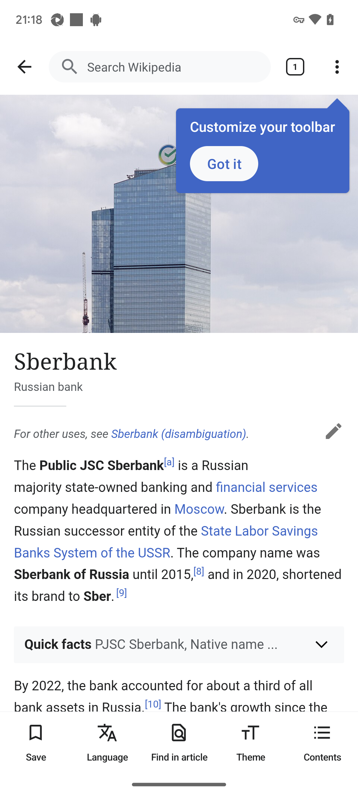

# 📱 Mobile Tests (Wikipedia)

Репозиторий содержит автоматизированные тесты мобильного приложения **Wikipedia**.
Проект демонстрирует работу с Appium и Selenide, запуск Android-тестов на реальных
устройствах BrowserStack и создание отчётов Allure.

## ✅ Стек

- Java 17+
- JUnit 5
- Selenide + Appium
- BrowserStack
- OWNER
- Jenkins
- Allure Report

## ✅ Тесты

В пакете `tests` реализованы четыре проверки:

1. **Поиск статьи:** открытие поиска, ввод запроса `Sberbank`, проверка наличия результатов.
2. **Открытие статьи:** выбор статьи `Sberbank` и проверка отображения заголовка и содержимого.
3. **Очистка поиска:** удаление введённого запроса кнопкой крестика и проверка исчезновения результатов.
4. **Главный экран:** прохождение приветственных экранов и проверка открытия главного экрана Wikipedia.

Тесты запускаются на **Android**. Текущая конфигурация: **Google Pixel 7 / Android 13.0**.

## 📊 Jenkins и Allure

[](https://jenkins.qa.guru/job/42_Chukanova_mobile/)
[](https://jenkins.qa.guru/job/42_Chukanova_mobile/allure/)

В Jenkins можно запустить сборку и просмотреть результат
в **Allure Report**. Отчёт содержит шаги тестов, скриншоты, структуру экрана и
ссылки на видеозаписи выполнения в BrowserStack.

## 📸 Визуализация тестов

Скриншоты из успешного запуска на Google Pixel 7:

<p align="center">
  
  &nbsp;&nbsp;
  
</p>

Видеозаписи доступны во вложениях **Video** к тестам в Allure.

## ⚙️ Настройка

Настройки устройства и приложения находятся в `src/test/resources/config.properties`.
Перед запуском загрузите APK Wikipedia в **BrowserStack App Automate** и укажите
полученный идентификатор `bs://...` в параметре `app`.

Логин и ключ для запуска в BrowserStack с компьютера задаются в файле
`.gradle/browserstack.properties`, который исключён из Git:

```properties
userName=YOUR_USERNAME
accessKey=YOUR_ACCESS_KEY
```

Тесты адаптированы под APK `50617-alpha-2026-11-13`. При использовании другой версии
приложения может потребоваться обновление локаторов.

### Локальный режим — пример конфигурации

`LocalConfig` через OWNER читает настройки из `src/test/resources/local.properties`.
Готовый шаблон находится в `src/test/resources/local.properties.example` и содержит
**примерные данные**. Если личный файл отсутствует, OWNER использует значения шаблона.
Перед локальным запуском скопируйте шаблон и укажите параметры своего устройства:

```bash
cp src/test/resources/local.properties.example src/test/resources/local.properties
```

Личный `local.properties` исключён из Git. Пример настроек:

```properties
local.appiumUrl=http://127.0.0.1:4723
local.deviceName=Pixel_7_API_33
local.platformVersion=13.0
local.udid=emulator-5554
local.appPackage=org.wikipedia.alpha
local.appActivity=org.wikipedia.main.MainActivity
local.appPath=build/apps/wikipedia.apk
local.appUrl=
```

Для фактического локального запуска нужны Appium с UiAutomator2, Android SDK,
запущенный эмулятор или подключённый телефон и APK Wikipedia.
Локальный режим подготовлен в коде, но **не проверен на устройстве**.
Если APK по указанному пути отсутствует, драйвер скачает его по прямой ссылке
`local.appUrl`. Если ссылка не задана, он сообщит об отсутствующем APK.
Пустые `local.platformVersion` и `local.udid` не передаются в Appium.
Драйвер использует полный сброс приложения перед запуском и отключает анимации окон.

## 🚀 Запуск

Все тесты:

```bash
./gradlew clean test
```

По умолчанию используется BrowserStack. Режим выбирается в `TestBase.@BeforeAll`:

```bash
./gradlew test -DrunMode=browserstack
./gradlew test -DrunMode=local -Dlocal.appPath=/path/to/wikipedia.apk
```

Любой параметр `local.*` можно переопределить через `-D`. В обоих режимах после теста
добавляются скриншот и структура экрана, затем закрывается сессия.
Видео BrowserStack добавляется только при удалённом запуске.

Только тесты поиска:

```bash
./gradlew test --tests tests.SearchTests
```

Генерация и просмотр отчёта Allure:

```bash
./gradlew allureReport
./gradlew allureServe
```

Результаты Allure сохраняются в `build/allure-results`.

В Jenkins логин и ключ передаются через параметры сборки:

```text
clean test
-DbrowserstackUrl=${browserstack_url}
-DuserName=${user_name}
-DaccessKey=${access_key}
```

## 🗂️ Структура проекта

- `config` — конфигурации локального и BrowserStack-запуска через OWNER.
- `drivers` — создание AndroidDriver для выбранного режима.
- `screens` — локаторы и действия экранов приложения.
- `tests` — тестовые сценарии и общий класс TestBase.
- `helpers` — вложения Allure и получение видео из BrowserStack.
